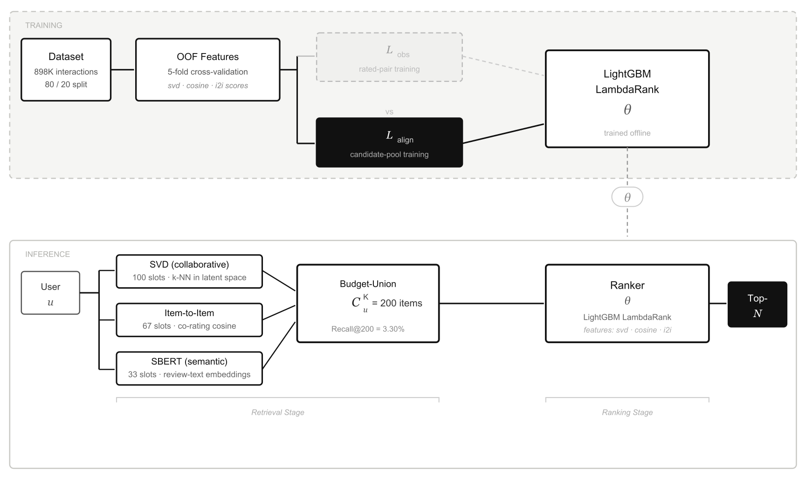

# TRACE-R2D

**Two-stage Recommender Attribution via Controlled Evaluation** for retrieval-to-ranking diagnostics.

Code for *Retrieval or Ranking? Diagnosing the Dominant Bottleneck in a Hybrid Two-Stage Recommender on a Sparse Product Catalogue.*

<p align="center">
  
</p>

A two-stage recommender built on Amazon Electronics Reviews 2023. SVD, SBERT and item-to-item signals retrieve a 200-item candidate pool, and a LightGBM LambdaRank model ranks it. Retrieval and ranking are measured separately to identify which stage limits end-to-end performance.

## Findings

- **Retrieval is the dominant bottleneck.** Recall@200 is 3.30%. Injecting the held-out item into the pool with the ranker held fixed raises HR@10 by 8.3×.
- **Training-serving alignment matters.** Training the ranker on retrieved candidates instead of observed pairs raises isolated HR@10 from 0.17 to 0.52. Feature attribution shows the corrected ranker relies mostly on item popularity.
- **Cold-start is the dominant regime.** 70% of users and 83% of items are cold. The semantic signal reaches cold items but not cold users.

## Setup

All commands run from the repository root.

```bash
pip install -r requirements.txt
python -m scripts.setup_data
python -m scripts.setup_sbert
```

## Reproducing the results

Run the pipeline, then build the candidate pool and train the aligned ranker:

```bash
python -m recsys.run
python -m training.measure_budget_recall
python -m training.build_candidate_ranker
python -m training.fix_candidate_leakage
```

Each result in the paper then has its own script in `experiments/`, run as `python -m experiments.<name>`:

| Result | Script |
|---|---|
| Main results | `final_results_table` |
| Retrieval recall | `measure_recall_conditions` |
| Ranker in isolation | `run_isolation_eval`, `recover_isolation_hr` |
| Beyond-accuracy metrics | `eval_beyond_accuracy` |
| Text-encoder comparison | `run_cnn_baseline` |
| Cold-start | `coldstart_experiment`, `coldstart_extended` |
| Oracle retrieval | `oracle_retrieval` |
| Initialisation variance | `confidence_intervals` |
| Candidate-budget ablation | `budget_ablation` |
| MovieLens density check | `ml_density_check` |

Results are written to `reports/`. To draw the figures and check every number in the paper against the results:

```bash
python -m scripts.make_new_figures
python -m scripts.final_check
```

## Structure

```
recsys/        core pipeline: data, features, retrieval, ranking, evaluation
training/      budget-union candidate pool and aligned ranker
experiments/   one script per result in the paper
scripts/       data setup, figures, number check
configs/       all tunable parameters
reports/       result files behind every reported number
paper/         LaTeX source and figures
```

## Data

- [Amazon Reviews 2023](https://huggingface.co/datasets/McAuley-Lab/Amazon-Reviews-2023), Electronics category, downloaded by `scripts/setup_data.py`
- MovieLens 20M, used only for the density check, expected at `MovieLens/rating.csv`

Neither dataset is included in this repository.
